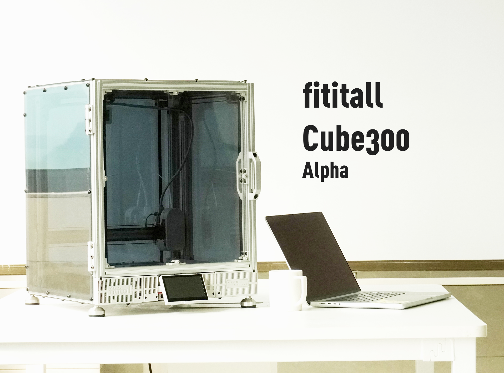

# fititall-3D

## [Bill of Materials & Assembly Guide](https://www.yuque.com/haibiandelaojidadianhua/prg0k5/idmribqft79v46gv?singleDoc)
## The naming convention for printed parts is as follows: Component + Position + Orientation + Quantity.
## For example, Y_Base_Down_Lb_cage_1.stl corresponds to Y-axis _Base _Bottom _Left-Back _Main Body _1 piece; pay special attention to the print quantity.
## 
#### Introduction
Cube300 is an open-source 3D printer equipped with the CrossingXZ^TM^ motion structure, developed and released by fititall3D. The project was entirely led and driven by industrial designers, striving to achieve the highest level of aesthetic appeal in its design. However, this does not mean that Cube300 lacks performance ambitions—it is capable of printing at a speed of 300mm/s with an acceleration of 15,000mm/s^2^. If you take a close look at every part of the printer, you will find that they strike a balance between performance and aesthetics.

The "make the most of everything" design philosophy of fititall3D runs throughout the development of Cube300, making the components easy to source. They are all "standard parts" or made from inexpensive materials, which also adheres to the "open-source spirit." We hope this approach lowers the economic barrier to joining the project and allows more people to benefit.

In the future, ease of use and reliability will continue to be the core principles guiding the project's iteration.

Welcome to join us.

tu
20230502
